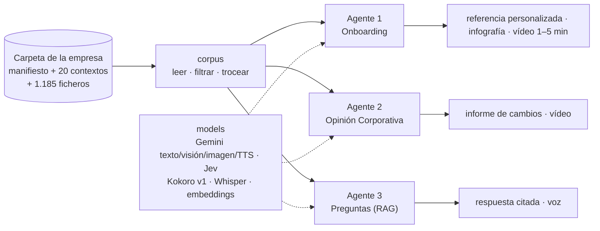

# B5T4 · Onboarding multimodal

**De la carpeta de trabajo de un equipo a su onboarding.** MVP del Taller B5-T4 (MIAX 14, Instituto BME).

Un equipo de gestión de carteras tiene escrito casi todo lo que un empleado nuevo necesita saber. Está repartido
en más de mil ficheros: manuales de sección, maestros Excel, informes, correos, PDF corporativos y plantillas.
El MVP lee esa carpeta y lo convierte en tres productos:

| # | Agente | Qué entrega | Modalidades |
|---|---|---|---|
| 1 | **Onboarding** | Conversación guiada, documento completo de referencia, infografía y **vídeo personalizado de 1 a 5 min** | conversación → investigación · informe HTML · diagramas · ilustración · voz · vídeo |
| 2 | **Opinión Corporativa** | Informe y **vídeo de los cambios** en la visión de la casa entre ediciones (p. ej. el bono de EE.UU. a 10 años pasa de infraponderar a sobreponderar) | PDF (texto e imagen) → visión → informe · voz · vídeo |
| 3 | **Preguntas** | Un agente al que cualquier empleado pregunta: *¿a qué correo va la operativa de Luxemburgo?* Responde **citando la fuente**, en **texto y en voz** | voz/texto → recuperación híbrida → texto · voz |

Caso real: la carpeta del equipo de **Gestión Discrecional de Andbank España** (1.185 ficheros, 7 secciones de
cartera, 17 personas).

> **Onboarding v2 (7-oct-2026):** conversación y confirmación del encargo, capítulos adaptados al perfil,
> revisiones documentales/editoriales/audiovisuales, marca Andbank y presupuesto por ejecución.
> Uso, contratos y límites: [docs/ONBOARDING_V2.md](docs/ONBOARDING_V2.md).
> Validación real: vídeos de 112,04 y 278,98 s y presupuesto verificado; revisión de integración documentada.
> Evidencia y ejemplos: [docs/VALIDACION_ONBOARDING_V2.md](docs/VALIDACION_ONBOARDING_V2.md).
> V1 se conserva en `codex/onboarding-completo`, commit `95fe4c5`, y sigue disponible sin `--brief`.
> Su validación: [docs/VALIDACION_ONBOARDING.md](docs/VALIDACION_ONBOARDING.md).
> Integra el agente 3 v0 ya disponible en `main`; el agente 2 conserva el listado de ediciones.
> Preparación del merge y puntos compartidos: [docs/INTEGRACION_ONBOARDING.md](docs/INTEGRACION_ONBOARDING.md).

---

## Cómo funciona



Tres ideas sostienen el diseño (detalle en [docs/ARQUITECTURA.md](docs/ARQUITECTURA.md)):

1. **La carpeta de datos está preparada para agentes.** Cada carpeta tiene un `00_CONTEXTO.md` con la misma
   plantilla de 11 secciones (Qué es · Responsables · Objetivos · …). Hay además un `00_MANIFIESTO.csv` con el
   estado de cada fichero (vigente, archivo o duplicado). Los agentes filtran antes de buscar y trocean por
   sección, no por número de caracteres.
2. **El modelo propone; los contratos y verificaciones controlan la entrega.** Los LLM seleccionan, redactan
   y dirigen la narrativa. Jev comprueba el respaldo documental; otras llamadas revisan la calidad editorial
   y visual. El código controla marca, presupuesto, persistencia y composición.
3. **El storyboard y la voz medida fijan el montaje.** Gemini TTS produce la voz de v2; Kokoro mantiene v1.
   Chromium dibuja componentes con GSAP/D3 y ffmpeg monta el MP4. Textos, cifras, logos y diagramas se dibujan
   por código; las ilustraciones generadas son conceptuales y se revisan.

---

## Puesta en marcha

Requisitos: [uv](https://docs.astral.sh/uv/) y Python 3.12. Windows, macOS o Linux.

```powershell
git clone https://github.com/GRUPO-TFM/B5T4-Multimodales.git; cd B5T4-Multimodales
copy .env.example .env          # rellena B5T4_DATA_DIR, OPENROUTER_API_KEY y JEV_API_KEY
uv sync                          # crea .venv con todas las dependencias
uv run playwright install chromium
uv run python scripts/download_models.py     # voz Kokoro, ~350 MB, una sola vez
uv run b5t4 check           # comprueba datos, claves y modelos
uv run b5t4 ui              # interfaz en http://127.0.0.1:7860
```

En Windows, `run.bat` hace todo lo anterior salvo el `.env`; en macOS y Linux, `./run.sh`. Los dos pasan sus
argumentos a `b5t4 ui` (por ejemplo, `run.bat --ngrok`).

### Enlace público con ngrok

Para enseñar la interfaz fuera de tu equipo sin desplegar nada:

1. Crea una cuenta gratuita en [ngrok](https://dashboard.ngrok.com/signup) y copia tu authtoken desde
   [Your Authtoken](https://dashboard.ngrok.com/get-started/your-authtoken).
2. Añádelo a `.env`: `NGROK_AUTHTOKEN=…`. Si vas a compartir el enlace, define también una contraseña:
   `B5T4_UI_AUTH=usuario:clave`.
3. Arranca con `uv run b5t4 ui --ngrok`. La consola muestra la dirección local y, debajo,
   `* Enlace público (ngrok): https://….ngrok-free.dev`.

No hay que instalar el programa `ngrok`: el agente va dentro de la dependencia `ngrok` que instala `uv sync`.
El túnel apunta al puerto que haya elegido Gradio (7860, o el siguiente libre) y se cierra con `Ctrl+C`,
junto con la interfaz.

- **Dirección.** La cuenta gratuita tiene un dominio fijo, que ngrok asigna solo. Para usar otro dominio
  reservado, `NGROK_DOMAIN=mi-dominio.ngrok.app` en `.env`.
- **Contraseña.** Sin `B5T4_UI_AUTH`, cualquiera con el enlace puede preguntar al corpus desde la pestaña 3; el
  arranque lo avisa. Con ella, Gradio pide usuario y clave antes de cargar la interfaz, también en local.
- **Un túnel por dirección.** Si ya hay un `ngrok` abierto con el mismo token (en esta máquina o en otra), el
  arranque puede fallar con un error `ERR_NGROK_…` de sesión o de dirección en uso: cierra el otro antes.
- **Primera visita.** En el plan gratuito, ngrok antepone una página de aviso («You are about to visit…») a
  quien abre el enlace en un navegador; basta con aceptarla para llegar a la interfaz.
- **Comprobación.** `uv run b5t4 check` indica si encuentra `NGROK_AUTHTOKEN` y si hay contraseña definida.

`uv run b5t4 ui --share` sigue disponible: usa el enlace temporal de Gradio y no necesita cuenta.

### A qué carpeta apunta

El repo **no contiene los datos**. Lee la carpeta indicada en `B5T4_DATA_DIR` (en `.env`) o, si no está, en
`data_dir` de `config/b5t4.toml`. Por defecto es:

```
C:/Users/javie/OneDrive/04. Andbank Work/Tarea MIAX
```

Cada miembro del equipo pone su ruta en su `.env`. Para ejecutar la demo sin acceso a los datos reales habrá una
copia anonimizada en `data/sample/` (pendiente).

Si la carpeta está en OneDrive, el cliente de OneDrive tiene que estar abierto o la carpeta marcada como
«Mantener siempre en este dispositivo». Con ficheros «solo en la nube» y OneDrive cerrado, la lectura falla con
`OSError: [Errno 22] Invalid argument` en los `.md` y `PdfiumError: Data format error` en los PDF.

### Comandos

| Comando | Qué hace | Estado |
|---|---|---|
| `uv run b5t4 check` | Comprueba la carpeta de datos, el manifiesto, los contextos, las claves, la voz y ffmpeg | ✅ |
| `uv run b5t4 onboarding --brief "encargo.json"` | Agente 1 v2 personalizado: referencia, infografía y vídeo de 1–5 min | ✅ |
| `uv run b5t4 onboarding` | Agente 1 v1. Informe verificado, infografía y vídeo ≤ 120 s | ✅ |
| `uv run b5t4 onboarding --report-only` | Agente 1. Genera el informe; permite borrador si no hay Jev | ✅ |
| `uv run b5t4 onboarding --resume "out/onboarding/<ejecución>"` | Agente 1. Reutiliza las etapas terminadas si las fuentes no cambiaron | ✅ |
| `uv run b5t4 opinion` | Agente 2. Informe para clientes de los cambios entre las dos últimas Opinión Corporativa: HTML (móvil) con la fuente de cada dato (línea literal + página + enlace al PDF), el «porqué» de cada cambio con cita literal verificada, 3 gráficos PNG y `cambios.json` en `out/opinion/` | ✅ v2 |
| `uv run b5t4 opinion --referencia` | Agente 2 sin LLM en la lectura de los PDF (extracción de referencia de `evals/`): para probar sin claves | ✅ |
| `uv run b5t4 opinion --eval` | Agente 2. ¿Lee bien el LLM los PDF? Aciertos frente a la referencia, por bloque | ✅ |
| `uv run b5t4 opinion --video` | Agente 2. Además del informe, vídeo resumen de ≤ 2 min (voz Gemini TTS por OpenRouter, ≈ 0,03 $; Kokoro local de respaldo) con los cambios y el «porqué» de la casa, en `out/opinion/<fecha>/video/video.mp4` | ✅ v2 |
| `uv run b5t4 rag chunks` | Agente 3. Trocea el corpus (~2.700 fragmentos con metadatos) | ✅ |
| `uv run b5t4 rag index` | Agente 3. Construye el índice BM25 en `index/` (≈ 3 s; repetir si cambian los datos) | ✅ |
| `uv run b5t4 rag ask "…" [--voice]` | Agente 3. Respuesta citada; en voz con `--voice`. Sin clave de OpenRouter, modo extractivo (enseña el pasaje) | ✅ v0 |
| `uv run b5t4 rag eval [--answers]` | Agente 3. Mide el buscador con el golden set: recall@1/3/8 (hoy 5 · 12 · 14 de 14) | ✅ |
| `uv run b5t4 ui [--share]` | Interfaz Gradio con las tres pestañas | ✅ (muestra «pendiente» donde corresponde) |
| `uv run b5t4 ui --ngrok` | La misma interfaz con enlace público por ngrok (`NGROK_AUTHTOKEN` en `.env`; contraseña opcional con `B5T4_UI_AUTH`) | ✅ |
| `uv run pytest` | Pruebas de datos, fuentes, verificación, reanudación, interfaz y render | Incluye regresiones del onboarding |

---

## Estructura del repositorio

```
├── README.md                    este documento
├── pyproject.toml · uv.lock     dependencias (uv)
├── .env.example                 plantilla de claves y ruta de datos (.env no se sube)
├── run.bat · run.sh             arranque en un paso
├── config/
│   └── b5t4.toml           rutas, modelos, parámetros de vídeo y RAG
├── docs/
│   ├── ARQUITECTURA.md          capas, diagramas de los tres agentes, modalidades, principios
│   ├── DECISIONES.md            registro de decisiones
│   └── PLAN.md                  reparto, calendario hasta el 8-oct y guion de la demo
├── src/b5t4/
│   ├── config.py                configuración (toml + .env)
│   ├── cli.py                   línea de comandos «b5t4 …»
│   ├── corpus/                  CAPA DE DATOS: manifest.py · contexts.py · extract.py
│   ├── models/                  CAPA DE IA: openrouter.py (multimodal/presupuesto) · llm.py · verifier.py · tts.py
│   │                            · stt.py · embeddings.py (pendientes)
│   ├── render/                  CAPA DE SALIDA: report.py · video.py · infographic.py · templates/
│   ├── agents/                  LÓGICA DE NEGOCIO, un agente por carpeta
│   │   ├── onboarding/          agente 1
│   │   ├── opinion/             agente 2 (tts.py: voz Gemini con caché por frase y respaldo Kokoro)
│   │   └── rag/                 agente 3: index.py · answer.py
│   └── app/                     CAPA DE INTERFAZ: ui.py (aplicación) · ui_onboarding.py (pestaña 1)
├── evals/preguntas_rag.yaml     golden set del agente 3 (15 preguntas con fuente; 1 trampa)
├── notebooks/                   exploración del corpus
├── scripts/                     download_models.py · jev_benchmark.py
├── tests/                       pruebas (pytest)
└── data/ · models/ · out/ · index/   fuera de Git (datos, voz, salidas, índice)
```

---

## Costes y privacidad

- **Coste por ejecución v2:** presupuesto inicial de 5 USD en OpenRouter para texto, revisiones, ilustraciones
  y voz. Reserva antes de llamar y registro del coste comunicado. Jev se contabiliza por separado.
  Chromium y ffmpeg funcionan localmente. V1 conserva su voz local.
- **Datos:** el corpus y los artefactos se guardan localmente y quedan fuera de Git. La redacción envía los
  fragmentos seleccionados a OpenRouter; la verificación envía afirmaciones y pasajes a Jev/TypeSafe.
  En v2 la síntesis de voz también utiliza OpenRouter; la composición y el montaje se ejecutan localmente.
  El `golden set` contiene correos internos de
  mesas, así que el repositorio debe ser **privado**.
- **Enlace público:** con `--ngrok` o `--share` la interfaz, y con ella las respuestas sobre el corpus, queda
  accesible desde internet mientras el proceso esté abierto. Define `B5T4_UI_AUTH` antes de compartir el enlace
  y cierra el proceso al terminar. El authtoken de ngrok es personal y vive solo en `.env`.

## Equipo

Organización [GRUPO-TFM](https://github.com/GRUPO-TFM) · Taller B5-T4 · MIAX 14. Repositorio privado
`GRUPO-TFM/B5T4-Multimodales`. Reparto de trabajo y reglas del equipo en [docs/PLAN.md](docs/PLAN.md).
