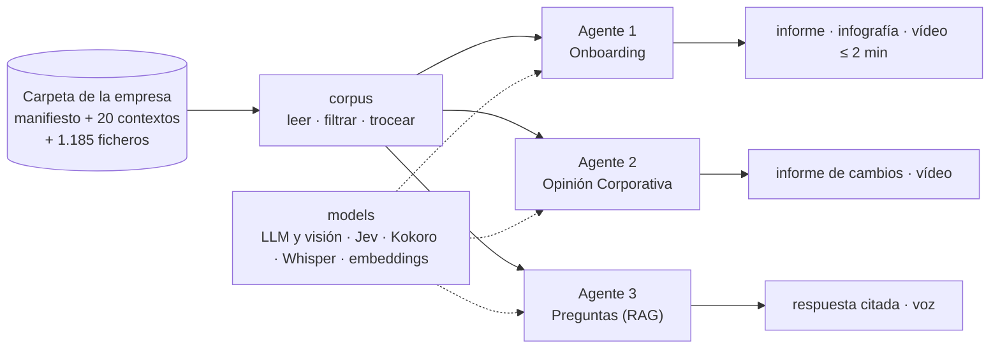

# B5T4 · Onboarding multimodal

**De la carpeta de trabajo de un equipo a su onboarding.** MVP del Taller B5-T4 (MIAX 14, Instituto BME).

Un equipo de gestión de carteras tiene escrito casi todo lo que un empleado nuevo necesita saber. Está repartido
en más de mil ficheros: manuales de sección, maestros Excel, informes, correos, PDF corporativos y plantillas.
El MVP lee esa carpeta y lo convierte en tres productos:

| # | Agente | Qué entrega | Modalidades |
|---|---|---|---|
| 1 | **Onboarding** | Informe escrito, infografía y **vídeo narrado de ≤ 2 min** que explica el equipo a una persona nueva: secciones, jerarquía, quién hace qué, objetivos, calendario y reglas | texto → informe HTML · diagramas · voz · vídeo |
| 2 | **Opinión Corporativa** | Informe y **vídeo de los cambios** en la visión de la casa entre ediciones (p. ej. el bono de EE.UU. a 10 años pasa de infraponderar a sobreponderar) | PDF (texto e imagen) → visión → informe · voz · vídeo |
| 3 | **Preguntas** | Un agente al que cualquier empleado pregunta: *¿a qué correo va la operativa de Luxemburgo?* Responde **citando la fuente**, en **texto y en voz** | voz/texto → recuperación híbrida → texto · voz |

Caso real: la carpeta del equipo de **Gestión Discrecional de Andbank España** (1.185 ficheros, 7 secciones de
cartera, 17 personas).

> **Estado (5-oct-2026):** estructura, configuración, capa de datos, motor de vídeo e interfaz funcionando. De
> cada agente está hecho el primer paso; el resto está especificado en el docstring de su `pipeline.py`. Ver
> [docs/PLAN.md](docs/PLAN.md).

---

## Cómo funciona



Tres ideas sostienen el diseño (detalle en [docs/ARQUITECTURA.md](docs/ARQUITECTURA.md)):

1. **La carpeta de datos está preparada para agentes.** Cada carpeta tiene un `00_CONTEXTO.md` con la misma
   plantilla de 11 secciones (Qué es · Responsables · Objetivos · …). Hay además un `00_MANIFIESTO.csv` con el
   estado de cada fichero (vigente, archivo o duplicado). Los agentes filtran antes de buscar y trocean por
   sección, no por número de caracteres.
2. **El LLM redacta; el código decide.** Extraer, comparar, maquetar y dibujar el vídeo es determinista. Lo que
   escribe un modelo se valida contra un esquema y se verifica contra su fuente con Jev, un verificador con
   probabilidad calibrada.
3. **El vídeo se dibuja, no se genera.** Primero se escribe un storyboard. La voz (Kokoro, local) fija la duración
   de cada escena. Chromium dibuja los fotogramas y ffmpeg monta el MP4. Cada cifra y cada nombre en pantalla
   sale de un documento.

---

## Puesta en marcha

Requisitos: [uv](https://docs.astral.sh/uv/) y Python 3.12. Windows, macOS o Linux.

```powershell
git clone https://github.com/GRUPO-TFM/B5T4-Multimodales.git; cd B5T4-Multimodales
copy .env.example .env          # y rellena B5T4_DATA_DIR y OPENROUTER_API_KEY
uv sync                          # crea .venv con todas las dependencias
uv run playwright install chromium
uv run python scripts/download_models.py     # voz Kokoro, ~350 MB, una sola vez
uv run b5t4 check           # comprueba datos, claves y modelos
uv run b5t4 ui              # interfaz en http://127.0.0.1:7860
```

En Windows, `run.bat` hace todo lo anterior salvo el `.env`.

### A qué carpeta apunta

El repo **no contiene los datos**. Lee la carpeta indicada en `B5T4_DATA_DIR` (en `.env`) o, si no está, en
`data_dir` de `config/b5t4.toml`. Por defecto es:

```
C:/Users/javie/OneDrive/04. Andbank Work/Tarea MIAX
```

Cada miembro del equipo pone su ruta en su `.env`. Para ejecutar la demo sin acceso a los datos reales habrá una
copia anonimizada en `data/sample/` (pendiente).

### Comandos

| Comando | Qué hace | Estado |
|---|---|---|
| `uv run b5t4 check` | Comprueba la carpeta de datos, el manifiesto, los contextos, las claves, la voz y ffmpeg | ✅ |
| `uv run b5t4 onboarding` | Agente 1. Hoy escribe el dosier de partida en `out/onboarding/` | 🟡 paso 1 de 6 |
| `uv run b5t4 opinion` | Agente 2. Hoy lista las ediciones de la Opinión Corporativa | 🟡 paso 1 de 5 |
| `uv run b5t4 rag chunks` | Agente 3. Trocea el corpus (~2.700 fragmentos con metadatos) | ✅ |
| `uv run b5t4 rag index` | Agente 3. Construye el índice BM25 en `index/` (≈ 3 s; repetir si cambian los datos) | ✅ |
| `uv run b5t4 rag ask "…" [--voice]` | Agente 3. Respuesta citada; en voz con `--voice`. Sin clave de OpenRouter, modo extractivo (enseña el pasaje) | ✅ v0 |
| `uv run b5t4 rag eval [--answers]` | Agente 3. Mide el buscador con el golden set: recall@1/3/8 (hoy 5 · 12 · 14 de 14) | ✅ |
| `uv run b5t4 ui [--share]` | Interfaz Gradio con las tres pestañas | ✅ (muestra «pendiente» donde corresponde) |
| `uv run pytest` | Pruebas de la capa de datos y del render | ✅ 7 pruebas |

---

## Estructura del repositorio

```
├── README.md                    este documento
├── pyproject.toml · uv.lock     dependencias (uv)
├── .env.example                 plantilla de claves y ruta de datos (.env no se sube)
├── run.bat · run.sh             arranque en un paso
├── config/
│   └── b5t4.toml           rutas, modelos, parámetros de vídeo y RAG
├── docs/
│   ├── ARQUITECTURA.md          capas, diagramas de los tres agentes, modalidades, principios
│   ├── DECISIONES.md            registro de decisiones
│   └── PLAN.md                  reparto, calendario hasta el 8-oct y guion de la demo
├── src/b5t4/
│   ├── config.py                configuración (toml + .env)
│   ├── cli.py                   línea de comandos «b5t4 …»
│   ├── corpus/                  CAPA DE DATOS: manifest.py · contexts.py · extract.py
│   ├── models/                  CAPA DE IA: llm.py (texto, JSON, visión) · verifier.py (Jev) · tts.py (Kokoro)
│   │                            · stt.py · embeddings.py (pendientes)
│   ├── render/                  CAPA DE SALIDA: report.py · video.py · infographic.py (pendiente) · templates/
│   ├── agents/                  LÓGICA DE NEGOCIO, un agente por carpeta
│   │   ├── onboarding/          agente 1
│   │   ├── opinion/             agente 2
│   │   └── rag/                 agente 3: index.py · answer.py
│   └── app/ui.py                CAPA DE INTERFAZ (Gradio)
├── evals/preguntas_rag.yaml     golden set del agente 3 (15 preguntas con fuente; 1 trampa)
├── notebooks/                   exploración del corpus
├── scripts/                     download_models.py · jev_benchmark.py
├── tests/                       pruebas (pytest)
└── data/ · models/ · out/ · index/   fuera de Git (datos, voz, salidas, índice)
```

---

## Costes y privacidad

- **Coste por ejecución:** modelos baratos por OpenRouter (DeepSeek / Gemini Flash). Voz, vídeo y embeddings
  corren en local y gratis. Las cifras medidas se añadirán al cerrar cada agente.
- **Privacidad:** los datos de la empresa, el índice del RAG y las salidas generadas no salen del PC: están
  fuera de Git. El `golden set` contiene correos internos de mesas, así que el repositorio debe ser **privado**.

## Equipo

Organización [GRUPO-TFM](https://github.com/GRUPO-TFM) · Taller B5-T4 · MIAX 14. Repositorio privado
`GRUPO-TFM/B5T4-Multimodales`. Reparto de trabajo y reglas del equipo en [docs/PLAN.md](docs/PLAN.md).
