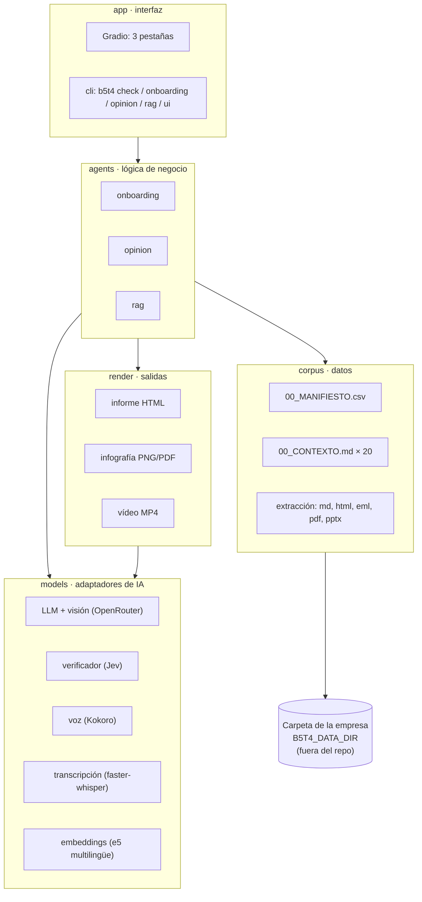
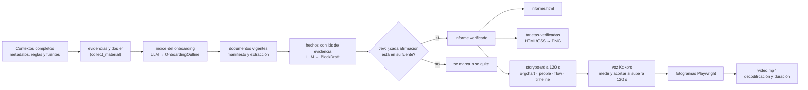
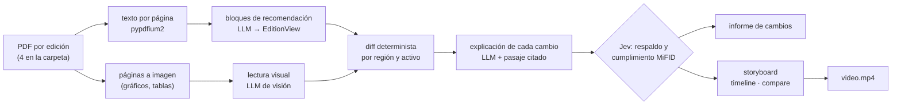
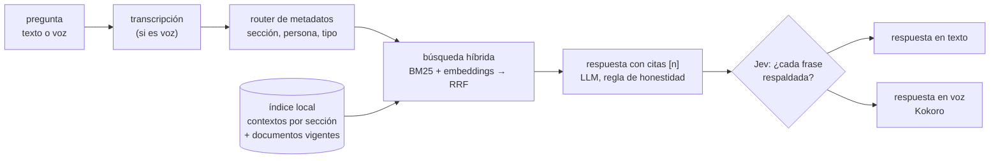

# Arquitectura del MVP B5-T4

## 1. La idea en una frase

Una empresa ya tiene escrito casi todo lo que un empleado nuevo necesita saber, pero repartido en cientos de
ficheros. El MVP lee esa carpeta y lo devuelve en tres formatos: **un onboarding** (informe, infografía y
vídeo de ≤ 2 min), **un vídeo de los cambios en la opinión corporativa** y **un agente al que preguntar**,
con respuesta citada en texto y en voz.

## 2. Capas

Las capas van de abajo arriba. Cada una solo usa las de debajo, así que se puede cambiar el proveedor de un
modelo sin tocar un agente, o la interfaz sin tocar la lógica.

| Capa | Carpeta | Responsabilidad | Estado |
|---|---|---|---|
| Configuración | `src/b5t4/config.py`, `config/b5t4.toml`, `.env` | Rutas, claves, modelos y parámetros; nada está escrito a fuego en el código | Hecho |
| Datos | `src/b5t4/corpus/` | Leer el manifiesto, los contextos (troceados por sección) y el texto de cualquier fichero; rasterizar páginas de PDF | Hecho |
| Modelos | `src/b5t4/models/` | Un adaptador por modalidad con interfaz mínima | LLM, Jev y TTS hechos; STT y embeddings pendientes |
| Salidas | `src/b5t4/render/` | Informe HTML responsive, infografía, vídeo por fotogramas | Informe, infografía y escenas de onboarding implementados; motor de vídeo compartido por los agentes 1 y 2 (el 2 aporta su plantilla y su voz) |
| Lógica | `src/b5t4/agents/` | Los tres agentes | Agente 1: onboarding v1/v2 completo. Agente 2: v2 completa (selección → extracción texto+visión con caché → diff determinista → frase por cambio + porqué con cita literal, ambos con Jev → HTML/PNG/JSON → vídeo con Gemini TTS). Agente 3: v0 funcionando (BM25 + LLM con citas + voz; recall@8 = 14/14 en el golden set) |
| Interfaz | `src/b5t4/app/`, `cli.py` | Gradio y línea de comandos; enlace público opcional con ngrok (`b5t4 ui --ngrok`) | Hecho (muestra «pendiente» donde corresponde) |

## 3. Por qué la carpeta de datos importa tanto

La copia estructurada (`Tarea MIAX`) no es una carpeta cualquiera. Se preparó para que la leyeran agentes:

- **`00_MANIFIESTO.csv`**: una fila por fichero con carpeta, sección, tipo, estado (vigente / archivo /
  duplicado) y md5. Permite **filtrar antes de buscar**: un agente ignora archivo y duplicados sin leerlos.
- **Veinte `00_CONTEXTO.md` con la misma plantilla de 11 secciones** (Qué es · Responsables · Objetivos ·
  Entregables · Procesos · Tipos de archivo · Dónde está cada cosa · Reglas · Incoherencias · FAQ · Fuentes).
  Esto da al RAG fragmentos con sentido completo y etiquetados igual en todas las carpetas, y al onboarding un
  guion ya ordenado.
- **Índices derivados** como `00_EVOLUCION_RECOMENDACIONES.md`, que sirve de referencia (*golden set*) para el
  agente 2.

## 4. Los tres agentes

### 4.1 Agente 1 · Onboarding

La regla del prototipo se mantiene: **el informe verificado es la única fuente** de la infografía y del vídeo.
Ninguno vuelve a leer documentos ni se inventa nombres o cifras. Presupuesto: 2 min ≈ 250 palabras de locución.

Cada bloque conserva hechos, evidencias, probabilidades y pendientes. Las tarjetas y la locución se comprueban
contra los hechos publicables del informe. Las etapas JSON y los hashes permiten reanudar una ejecución cuando
sus fuentes no han cambiado. Detalle operativo: [ONBOARDING.md](ONBOARDING.md).

### 4.2 Agente 2 · Evolución de la Opinión Corporativa

La comparación la hace **Python, no el LLM**. El LLM extrae las recomendaciones a una estructura fija y
después explica el porqué de cada cambio citando el texto. Así un cambio no puede «alucinarse»: o está en el
diff o no existe.

### 4.3 Agente 3 · Preguntas de empleados (RAG)

- **Qué se indexa:** las secciones de los contextos (escritas para responder) y los documentos vigentes de texto
  (README, instrucciones, LEEME, fichas, contratos, correos, informes, PDF). Hoy son unos 2.700 fragmentos.
- **Por qué híbrido:** las preguntas están llenas de nombres propios, correos y siglas (CCV, NDEEWNR, P4), que la
  similitud semántica sola recupera mal. BM25 los clava; los embeddings resuelven paráfrasis
  («operativa de Luxemburgo» ≈ «órdenes del Unit Link»).
- **Honestidad:** si los fragmentos no contienen la respuesta, se responde «no consta». El golden set incluye una
  pregunta trampa para medirlo.

## 5. Modalidades (criterio 4.2 del enunciado)

| Modalidad | Entrada / salida | Dónde | Modelo |
|---|---|---|---|
| Texto (md, html, eml, pptx) | Entrada | corpus | — |
| PDF con texto | Entrada | corpus (pypdfium2) | — |
| Imagen (páginas de PDF, gráficos) | Entrada | agente 2 | LLM de visión |
| Voz (pregunta hablada) | Entrada | agente 3 | faster-whisper |
| Texto estructurado (JSON validado) | Interna | los tres | LLM |
| Informe HTML | Salida | agentes 1 y 2 | — |
| Infografía (diagramas) | Salida | agente 1 | HTML/CSS + Playwright |
| Voz sintética | Salida | agentes 1, 2 y 3 | Kokoro |
| Vídeo con motion graphics | Salida | agentes 1 y 2 | Playwright + ffmpeg |

Cada modalidad está en el camino crítico de un flujo de usuario. Si se quita, el usuario pierde algo.

## 6. Principios de diseño

1. **Pipelines deterministas; LLM solo donde hay juicio.** Extraer, comparar, maquetar y renderizar es código.
   Resumir, explicar y redactar es LLM.
2. **Todo lo que escribe un LLM se valida contra un esquema Pydantic** antes de pasar a la etapa siguiente.
3. **Ninguna cifra ni nombre sale de un generador de imágenes o de vídeo.** El vídeo se dibuja desde datos.
4. **Cada afirmación lleva su fuente**, y el verificador mide la probabilidad de que la fuente la respalde.
5. **Los datos no viven en el repo.** El repo apunta a la carpeta. Índices y salidas quedan fuera de Git.
6. **Coste:** modelos baratos por OpenRouter (DeepSeek / Gemini Flash); voz, vídeo y embeddings en local.
