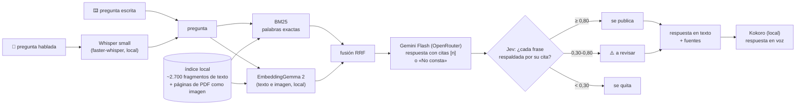

# Agente 3 · Preguntas de empleados (RAG) — v1

Un empleado pregunta, **hablando o escribiendo**, lo que preguntaría a un compañero («¿a qué correo va la
operativa de Luxemburgo?»). El agente busca en la carpeta del equipo, responde **citando la fuente**, **verifica
cada frase** contra lo que cita y contesta también **en voz**.

## 1. Flujo y modelos



| Paso | Modalidad | Modelo | Dónde corre | Fichero |
|---|---|---|---|---|
| Voz → texto | audio → texto | Whisper `small` (faster-whisper, int8) | local, CPU | `models/stt_whisper.py` |
| Búsqueda léxica | texto | BM25 propio (Okapi, k1 = 1,4, b = 0,75) + raíz en español | local | `agents/rag/index.py` |
| Búsqueda semántica | texto **e imagen** | EmbeddingGemma 2 (Google, 6-oct-2026, Apache 2.0), 256 d | local, CPU | `models/embed_gemma.py`, `agents/rag/dense.py` |
| Fusión | — | Reciprocal Rank Fusion (K = 60) | local | `agents/rag/hybrid.py` |
| Respuesta | texto → texto | Gemini Flash vía OpenRouter, temperatura 0, JSON validado | nube | `agents/rag/answer.py` |
| Verificación | texto × texto | Jev (TypeSafe), probabilidad calibrada | nube | `agents/rag/verify.py` |
| Voz | texto → audio | Kokoro (ONNX) | local, CPU | `models/tts.py` |

Son **cinco modelos especializados encadenados** (Whisper → EmbeddingGemma 2 → LLM → Jev → Kokoro), cada uno en
lo que hace mejor, y cuatro modalidades (audio, texto, imagen de página, audio de salida).

### Por qué la búsqueda multimodal
Las páginas de los PDF de la Opinión Corporativa se indexan también **como imagen**. EmbeddingGemma 2 pone texto e
imagen en el mismo espacio, así que una pregunta («¿qué opina la casa del bono a 10 años de EE.UU.?») puede encontrar
la página por la **tabla o el gráfico** que contiene, aunque su texto extraído sea pobre. Al LLM se le pasa el texto
de esa página y la cita aparece como «p. N (imagen)».

## 2. Cómo se ejecuta

Requisitos: lo de siempre (`uv sync`, `.env` con `B5T4_DATA_DIR` y `OPENROUTER_API_KEY`, `uv run b5t4 rag index`).
`JEV_API_KEY` es opcional: sin ella la respuesta sale sin verificar y la interfaz lo dice.

Whisper y EmbeddingGemma 2 **no se añaden a `pyproject.toml`** a propósito: `transformers` 5.19 y `faster-whisper`
obligan a bajar `huggingface-hub` (2.1 → 1.33) para todo el proyecto. Los scripts los cargan con `uv run --with`, en
un entorno superpuesto que no toca el del resto del equipo.

```powershell
.\scripts\rag_v1.ps1 dense                    # una vez: índice denso (descarga ~1,5 GB la primera vez)
.\scripts\rag_v1.ps1 compare                  # BM25 vs denso vs híbrido con el golden set
.\scripts\rag_v1.ps1 compare --answers hybrid # + respuestas completas (gasta LLM)
.\scripts\rag_v1.ps1 ui                       # interfaz con micrófono → http://127.0.0.1:7861
.\scripts\rag_v1.ps1 voz pregunta.wav         # pregunta por voz desde la consola
```
En macOS / Linux, lo mismo con `./scripts/rag_v1.sh`.

## 3. Resultados

Golden set: `evals/preguntas_rag.yaml`, 15 preguntas (14 con fuente esperada + 1 trampa sin respuesta).
Recall@k = de las 14, en cuántas sale una fuente correcta entre los k primeros fragmentos.

Medido el 7-oct-2026 en el PC de Javi (CPU), `scripts/rag_compare.py`. MRR = media de 1/posición de la primera
fuente correcta (1 = siempre la primera).

| Buscador | recall@1 | recall@3 | recall@8 | MRR | latencia por pregunta |
|---|---|---|---|---|---|
| BM25 (v0) | 5/14 | 12/14 | **14/14** | 0,60 | 21 ms |
| Denso (EmbeddingGemma 2, 256 d) | 6/14 | 8/14 | 11/14 | 0,55 | ~40 ms (*) |
| Híbrido (RRF, K = 60) | **6/14** | **12/14** | **14/14** | **0,64** | 58 ms |

(*) La ejecución midió 1.557 ms de media porque la primera pregunta incluía cargar el modelo (unos 20 s, una vez
por arranque). Los ~40 ms salen de restar BM25 al híbrido; el script ya descarta esa primera llamada.

Posición de la primera fuente correcta (— = fuera de las 8 primeras):

| | q01 | q02 | q03 | q04 | q05 | q06 | q07 | q08 | q09 | q10 | q11 | q12 | q13 | q14 |
|---|---|---|---|---|---|---|---|---|---|---|---|---|---|---|
| BM25 | 2 | 5 | 1 | 1 | 1 | 3 | 4 | 1 | 2 | 2 | 3 | 2 | 1 | 3 |
| Denso | 2 | — | 1 | 1 | 1 | 2 | 4 | 1 | 1 | — | — | 4 | 1 | 4 |
| Híbrido | 2 | 6 | 1 | 1 | 1 | **1** | **2** | 1 | 2 | 8 | **2** | 3 | 1 | 3 |

**Lectura:**
- **El denso solo es peor que BM25.** Las preguntas usan el vocabulario exacto de los documentos (nombres,
  «Alpha», «5 %», «.eml»), que es donde gana la coincidencia de palabras. Falla q02, q10 y q11.
- **El híbrido iguala a BM25 en recall@3 y @8 y mejora la primera posición** (q06, q07, q11 suben; q02, q10, q12
  bajan). Con 14 preguntas es una pregunta de diferencia: **mejora pequeña, no concluyente.**
- **Para la respuesta final apenas cambia nada:** los dos dejan la fuente correcta entre las 8 que lee el LLM en
  las 14 preguntas.
- **q10 (2 → 8)** muestra el punto débil de RRF: si el denso no encuentra un fragmento, ese fragmento solo suma por
  un lado y lo adelantan otros que salen a media altura en las dos listas. Siguiente palanca: dar más peso a BM25
  en la fusión.
- **Las páginas como imagen no puntúan en este golden set:** la fuente esperada de q11 es un `.md`, no las páginas
  del PDF. Para medir la parte multimodal hacen falta preguntas cuya respuesta esté en una tabla o gráfico.

**Coste del denso:** índice de 2.796 vectores (2.703 fragmentos + 93 páginas de 4 PDF) en **40 min de CPU** (34,5 min
el texto, 4 min las imágenes), 1,5 GB de modelo y ~20 s de carga al arrancar. **Decisión:** la interfaz arranca con
BM25 y deja el híbrido como opción; el híbrido es el que aporta la búsqueda por imagen.

Tiempos de una pregunta completa (7-oct-2026, PC de Javi, CPU; v0 con BM25):

| Paso | Tiempo |
|---|---|
| Voz → texto (Whisper) | _pendiente_ |
| Búsqueda | 0,37 s |
| LLM (4.296 tokens de entrada → 530 de salida) | 6,1 s |
| Jev | _pendiente_ |
| Voz (Kokoro) | 8,3 s |
| **Total** | **14,8 s** |

El cuello de botella es la **síntesis de voz en CPU**, no el LLM. Mejora posible: sintetizar por frases y empezar
a reproducir la primera mientras se generan las demás.

**Coste por pregunta:** unos 4.300 tokens de entrada y 500 de salida en Gemini Flash; del orden de una fracción
de céntimo (estimación con el precio publicado, no factura medida). Whisper, embeddings y voz: 0 €, en local.

### Ejemplo de por qué hace falta verificar
En la prueba de Luxemburgo el LLM añadió el correo concreto de un banquero, mientras que la regla del documento
dice «con copia al banquero del cliente», sin nombre. Es justo el tipo de dato de más que Jev marca o quita.

## 4. Decisiones y parámetros (y por qué se cuestionan)

| Parámetro | Valor | Estado |
|---|---|---|
| BM25 `k1`, `b` | 1,4 · 0,75 | valores de manual; sin ajustar |
| `CONTEXT_BOOST` | ×1,15 a los `00_CONTEXTO.md` | arbitrario; candidato a explicar el 5/14 en primera posición |
| `top_k` | 8 | recall@3 ya es 12/14; se podría bajar a 5 y abaratar el prompt |
| Troceado | 450 tokens ≈ 337 palabras; el prompt recorta a 320 | las últimas ~17 palabras de los trozos largos no llegan al LLM |
| Tipos indexados | md, txt, eml, html, pdf | **pptx y Excel fuera** |
| Umbrales Jev | 0,80 publicar · 0,30 descartar | fijados con un banco de 12 casos; poco para calibrar |
| Embeddings | EmbeddingGemma 2 a 256 d | solo, peor que BM25; en híbrido, +1 en primera posición (MRR 0,60 → 0,64). Aporta la búsqueda por imagen |
| RRF `K` | 60 | valor del artículo original (Cormack et al., 2009) |
| Whisper | `small`, int8 | compromiso velocidad/calidad en CPU; `B5T4_STT_MODEL=large-v3-turbo` si sobra tiempo |

## 5. Privacidad
Todo lo que puede correr en local corre en local: transcripción, embeddings, índice y voz. Salen del PC solo
los fragmentos que se mandan al LLM (OpenRouter) y a Jev (TypeSafe). En OpenRouter se recomienda activar
«no usar para entrenamiento» y solo proveedores sin retención de datos.
